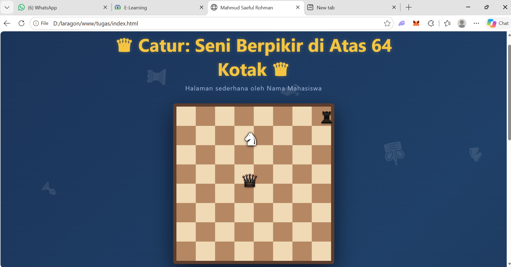
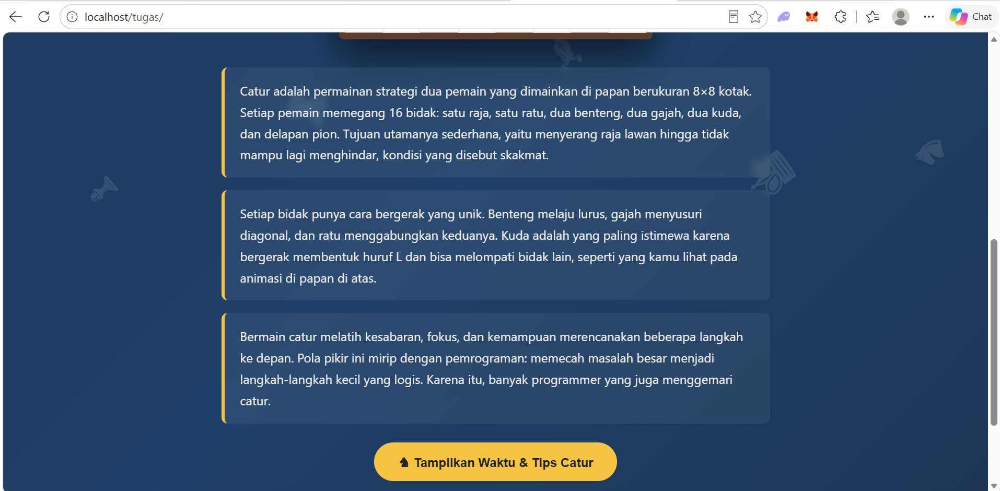
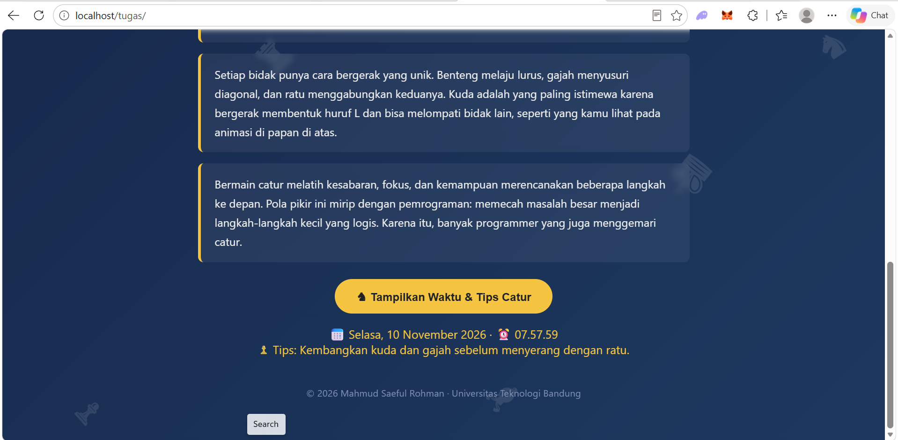

# Tugas Pemrograman Web 1 - Website Tema Catur

**Nama:** Mahmud Saeful Rohman
**NIM:** 24552011286
**Kelas:** TIF 24 CNS E

## Deskripsi
Website 1 halaman (satu file HTML) bertema catur, dengan animasi kuda melompat membentuk rute huruf L,
benteng yang meluncur, dan ratu yang berdenyut di atas papan catur CSS.

## Fitur
- **HTML + CSS:** judul halaman, 1 heading, 3 paragraf, background gradasi bergerak, papan catur dan animasi bidak.
- **JavaScript:** tombol yang menampilkan tanggal, jam, dan tips catur acak ke halaman.

## Screenshot

## Cara Menjalankan
LIVE DEMO : https://mahmudsaeful.github.io/Tugas-Elearning-24552011286/

atau

Buka file `index.html` di browser

